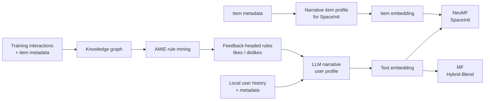

<div align="center">

# FOLMind

### Logic-Guided Hybrid Representations for Collaborative Recommendation

**From dataset-level symbolic regularities to narrative user profiles and collaborative ranking.**

[](https://aisocietylab.github.io/hyper26/)
[](https://cikm2026.diag.uniroma1.it/)
[](https://github.com/sisinflab/FOLMind)
[](LICENSE)

**Accepted at the Second International Workshop on Hybrid AI for Human-Centric Personalization and Recommendation (HyPeR 2026)**  
*Co-located with CIKM 2026 · November 8, 2026 · Rome, Italy*

[Workshop & program](https://aisocietylab.github.io/hyper26/) · [Repository](https://github.com/sisinflab/FOLMind) · [Reproduce the results](#reproducing-the-experiments) · [Citation](#citation)

</div>

---

> **Official research code.** This repository hosts the implementation and experimental pipeline accompanying the accepted paper **“FOLMind: Logic-Guided Hybrid Representations for Collaborative Recommendation.”**

## Why FOLMind?

An LLM can describe a user's preferences from their interaction history and item metadata. But a local history does not explicitly expose **relational regularities across the complete training interaction graph**. Knowledge graphs and mined First-Order Logic (FOL) rules provide a complementary, dataset-level view.

**FOLMind connects these views at the representation level:** mined feedback-oriented rules condition an LLM's narrative *user-profile generation*; a text embedding model maps those profiles to vectors; and an existing collaborative recommender performs the final ranking.

The key design decision is **soft symbolic guidance, not hard logical constraints**. Rules are contextual evidence for building representations. They are not enforced on recommendation scores, and the LLM does not replace the collaborative ranker.

### Results at a glance

| Comparison | Reported nDCG@10 improvement | What it measures |
| :-- | :-- | :-- |
| **Full FOLMind vs. collaborative baseline** | **+12.29% to +30.51%** | Benefit of the complete semantic-profile-enhanced configuration |
| **FOL vs. NoFOL** | **+0.34% to +7.10%** | Additional increment associated with supplying mined rules during user profiling |

Results are from **MovieLens 1M** and **Book Genome**, using **NeuMF + SpaceInit** and **MF + Hybrid-Blend**. Narrative profiles account for most of the overall improvement; symbolic conditioning supplies a smaller, dataset-dependent increment. We report these two comparisons separately to avoid attributing all gains to FOL.

## How it works



The diagram is a high-level overview. In the evaluated configuration, **feedback-headed rules condition user profiles**, while **item profiles for SpaceInit are generated from item metadata**. All knowledge-graph construction, rule mining, and profile generation use **training interactions only**.

### The five-stage pipeline

1. **Knowledge-graph construction.** Combine training-derived user feedback with semantic item metadata from an external knowledge base (DBpedia in the reported experiments).
2. **Symbolic rule extraction.** Mine Horn rules using **AMIE**, then retain rules whose heads express user feedback (`likes` or `dislikes`). These retained rules form dataset-level symbolic context; they are **not** a set of verified user-specific deductions.
3. **Narrative profile generation.** Provide local user history, corresponding item metadata, and retained rules to **Gemini 2.5 Flash Lite**. The LLM generates a concise user profile. A separate reasoning field is retained for inspection but is **not embedded** in the reported ranking experiments.
4. **Semantic embedding.** Encode narrative profile text using **Qwen3-Embedding-4B**, producing dense semantic representations.
5. **Collaborative integration.** Feed those representations to existing recommenders using one of the two interfaces below.

| Interface | Backbone | Where semantic information enters | Mechanism |
| :-- | :-- | :-- | :-- |
| **SpaceInit** | NeuMF | **Training time** | User and item profile vectors initialize trainable embedding tables, which are adapted jointly with the neural recommender. |
| **Hybrid-Blend** | Matrix Factorization | **Scoring time** | User-profile similarity defines semantic neighborhoods and their predictions, which are blended with the MF scores. |

**No online LLM call is required for each recommendation** after profiles and embeddings have been precomputed; profile construction is an offline step.

## Experimental results

The paper evaluates ranking at cutoff 10. Below, the absolute values are **nDCG@10**, and the percentages are relative changes (not percentage-point differences).

### Full configuration vs. collaborative baselines

| Backbone | Dataset | Baseline | FOLMind (FOL) | Relative gain |
| :-- | :-- | --: | --: | --: |
| NeuMF | MovieLens 1M | 0.2668 | 0.3203 | **+20.05%** |
| NeuMF | Book Genome | 0.0768 | 0.0956 | **+24.48%** |
| MF | MovieLens 1M | 0.2864 | 0.3216 | **+12.29%** |
| MF | Book Genome | 0.0613 | 0.0800 | **+30.51%** |

The full FOLMind configurations also improve Recall@10 and Precision@10 in all four evaluated dataset–backbone combinations (paper, Table 4).

### Symbolic contribution: FOL vs. NoFOL

The **NoFOL** condition keeps narrative-profile generation and its downstream integration but removes symbolic context from user-profile prompting.

| Backbone | Dataset | NoFOL | FOL | Relative FOL increment |
| :-- | :-- | --: | --: | --: |
| NeuMF | MovieLens 1M | 0.3192 | 0.3203 | **+0.34%** |
| NeuMF | Book Genome | 0.0903 | 0.0956 | **+5.87%** |
| MF | MovieLens 1M | 0.3201 | 0.3216 | **+0.47%** |
| MF | Book Genome | 0.0747 | 0.0800 | **+7.10%** |

On **Book Genome**, the symbolic increment is larger even though only **2 feedback-headed rules** were retained, compared with **59 on MovieLens 1M** (paper, Tables 1 and 5). This suggests that rule quantity alone does not explain the effect; explanations involving sparsity, relevance, and alignment require further evaluation.

> **Scope of the claims.** These experiments establish ranking differences within the evaluated configurations. They do not directly establish profile faithfulness, causal effects of sparsity, explanation quality, fairness, or user trust.

## Getting started

### Requirements

- Git
- [Miniconda](https://docs.conda.io/en/latest/miniconda.html) or [Anaconda](https://www.anaconda.com/)
- A compatible PyTorch setup (GPU recommended for profile embedding and neural experiments)
- A Google AI API key for the Gemini-based profile-generation stage

### Installation

```bash
git clone https://github.com/sisinflab/FOLMind.git
cd FOLMind

conda env create -f environment.yml
conda activate folm_env
```

Install PyTorch and PyG dependencies appropriate to your environment. The commands below are retained from this repository's original setup guidance; check compatibility with your Python, PyTorch, CUDA, and operating-system versions before running them.

<details>
<summary><strong>PyTorch / PyG installation examples</strong></summary>

**NVIDIA GPU (CUDA 12.1 example):**

```bash
pip3 install torch torchvision torchaudio --index-url https://download.pytorch.org/whl/cu121
pip install pyg_lib torch_scatter torch_sparse torch_cluster torch_spline_conv -f https://data.pyg.org/whl/torch-2.5.0+cu121.html
```

**CPU-only example:**

```bash
pip3 install torch torchvision torchaudio
pip install pyg_lib torch_scatter torch_sparse torch_cluster torch_spline_conv -f https://data.pyg.org/whl/torch-2.6.0+cpu.html
```

CPU-only environments may encounter compatibility or performance limitations for particular embedding-model configurations.

</details>

Verify the installed environment:

```bash
pip check
```

### Configure Gemini

Set up the Google AI key in the relevant local YAML configuration under `configs/` (the current pipeline expects an `LLMEmb.api_keys` entry):

```yaml
LLMEmb:
  api_keys:
    - "YOUR_GOOGLE_AI_API_KEY_HERE"
```

Get a key from [Google AI Studio](https://aistudio.google.com/app/apikey). **Never commit real API keys** or credential-containing local configuration files to the repository.

## Reproducing the experiments

The repository exposes three main entry points:

| Script | Purpose |
| :-- | :-- |
| `run.py` | Data preparation, KG extraction, AMIE mining, narrative profiling, and embeddings |
| `run_experiments.py` | Matrix Factorization / Hybrid-Blend experiments |
| `run_neural_experiments.py` | NeuMF / SpaceInit experiments |

The following commands reflect the examples from the repository's existing README. **For exact paper reproduction**, confirm the selected data split, FOL/NoFOL condition, embedding variant (**Qwen3-Embedding-4B**), and trained-backbone configuration. The pipeline example uses default model settings; consult `variantHandler.py` to select the intended embedding variant.

**1. Build the data/semantic pipeline:**

```bash
python run.py --config ml1m_base_settings_baseline.yml --run-all
```

**2. Run MF / Hybrid-Blend:**

```bash
python run_experiments.py -c ml1m_base_settings_qwen4BFOL.yml
```

**3. Run NeuMF / SpaceInit:**

```bash
python run_neural_experiments.py --config ml1m_optuna_neural_baseline.yml
python run_neural_experiments.py --config ml1m_optunaNewNMF_LLMEmb_QWEN4.yml
```

To isolate the symbolic increment, compare corresponding **NoFOL** and **FOL** configurations while keeping the semantic profiling and downstream evaluation pipeline comparable. The paper reports a **10-core filtered per-user random holdout** (20% test, 10% validation), and Book Genome is additionally stratified-subsampled. The KG, rule mining, and narrative profiling use **training data only**.

### Run pipeline stages individually

```bash
python run.py --config your_config.yml --run-crawler
python run.py --config your_config.yml --run-amie
python run.py --config your_config.yml --run_llm_calls
python run.py --config your_config.yml --run-llm-pipeline
```

The YAML configuration controls the dataset, preprocessing, rule-mining settings, prompts, and experiment parameters. Use configuration files available in `configs/` and `neural_configs/` as the starting points.

## Repository structure

| Path | Role |
| :-- | :-- |
| [`folm_core/`](folm_core/) | Core FOLMind implementation modules |
| [`configs/`](configs/) | Pipeline and MF configurations |
| [`neural_recommender/`](neural_recommender/) | NeuMF implementations and training components |
| [`neural_configs/`](neural_configs/) | Neural backbone configuration files |
| [`variantHandler.py`](variantHandler.py) | Model/representation variant selection |
| [`run.py`](run.py) | Main multi-stage pipeline entry point |
| [`run_experiments.py`](run_experiments.py) | MF experiments |
| [`run_neural_experiments.py`](run_neural_experiments.py) | NeuMF experiments |

## Citation

If you use FOLMind in your research, please cite our paper. The following BibTeX entry follows the DBLP format; publication metadata will be updated once the official proceedings and DBLP record become available.

```bibtex
@inproceedings{SmaldiniCPMDN26,
  author    = {Raffaele Smaldini and
               Gianni Carmosino and
               Dario Di Palma and
               Alberto Carlo Maria Mancino and
               Tommaso Di Noia and
               Fedelucio Narducci},
  title     = {FOLMind: Logic-Guided Hybrid Representations for
               Collaborative Recommendation},
  booktitle = {Proceedings of the Second International Workshop on
               Hybrid AI for Human-Centric Personalization and
               Recommendation (HyPeR 2026), co-located with the
               ACM International Conference on Information and
               Knowledge Management (CIKM 2026),
               Rome, Italy, November 8, 2026},
  pages     = {},
  year      = {2026},
  crossref  = {},
  url       = {},
  timestamp = {},
  biburl    = {},
  bibsource = {}
}
```


## Contributing

Contributions, issue reports, and suggestions for additional datasets, rule-selection methods, embedding models, and integration strategies are welcome. Please open an issue or submit a pull request describing the proposed change.

## License

The repository is distributed under the [Apache License 2.0](LICENSE). See the license file for terms and conditions.

---

<div align="center">

**FOLMind · Official implementation of the HyPeR 2026 accepted paper**

*Explicit logic - narrative representations - collaborative recommendation*

</div>
